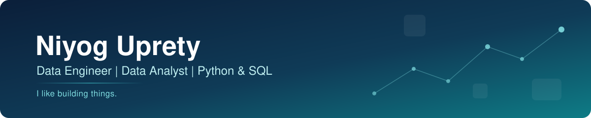
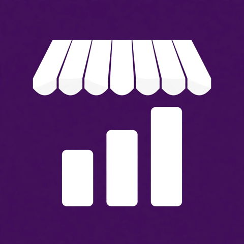

  

**Houston based · Data Engineer / Data Analyst · Graduating May 2027 · Open to full time data roles**

 

Hi, I'm Niyog. I like building data pipelines and then poking at the data they collect. Most
of my work is Python and SQL: getting data in reliably, keeping it honest, and turning it into
something I can actually answer questions with.

<!-- OBSERVATORY_STATS:START -->
51 employer boards checked three times a day · 148 open jobs tracked right now · 259 jobs kept in total · requirements extracted on 166 of 167 kept postings (99%) · updated 2026-11-05
<!-- OBSERVATORY_STATS:END -->

## Job Observatory

- **What it is:** a pipeline and website that collects job listings from employer boards and keeps every version of every listing, live on one AWS server since November 4, 2026.
- **The hard part:** an AI model pulls requirements out of each listing, and Python checks every answer against the listing text before dbt turns the history into reports. Only complete scans count as proof a job closed.

I host it on AWS, on one EC2 server. Python collectors pull the postings from <!--PROFILE:boards-->51<!--/PROFILE:boards--> Greenhouse and Lever boards, three times a day, and the jobs show up on the live site for anyone to search. Airflow runs the whole schedule: collection, extraction, the dbt build, and publishing, and it retries anything that failed every 15 minutes. Raw pages go to S3 as they are collected, and the database is backed up to S3, so the data is not only on the server.

An AI model reads each posting and pulls out the requirements, the location, and the job family into fixed fields. Every value it returns has to quote the posting it came from, word for word. dbt turns those fields into the reporting tables. The reports page and the dashboard feed are rebuilt from those tables at every publish, so the dashboards always run on the newest batch of data.

I also tested Spark. I rebuilt three of the reporting models in PySpark and ran them on Databricks, to see whether Spark would do that step better than PostgreSQL. It did not. The data is small enough to fit in one database, so Spark's overhead cost more than the parallel work saved, and the live system stayed on PostgreSQL. The Spark code and the timings are in the repo. Spark and Databricks are not part of the running system.

<picture><source media="(prefers-color-scheme: dark)" srcset="assets/stack/python-dark.svg"></picture>
<picture><source media="(prefers-color-scheme: dark)" srcset="assets/stack/postgresql-dark.svg"></picture>
<picture><source media="(prefers-color-scheme: dark)" srcset="assets/stack/dbt-dark.svg"></picture>
<picture><source media="(prefers-color-scheme: dark)" srcset="assets/stack/airflow-dark.svg"></picture>
<picture><source media="(prefers-color-scheme: dark)" srcset="assets/stack/aws-dark.svg"></picture>
<picture><source media="(prefers-color-scheme: dark)" srcset="assets/stack/docker-dark.svg"></picture>
<picture><source media="(prefers-color-scheme: dark)" srcset="assets/stack/databricks-dark.svg"></picture>

[Live site](https://jobobservatory.dev) · [Reports](https://jobobservatory.dev/reports) · [Source](https://github.com/Niyog59/Job-Market-Intelligence) · [What went wrong](https://github.com/Niyog59/Job-Market-Intelligence/blob/main/docs/PROBLEMS.md) · [Spark and Databricks comparison](https://github.com/Niyog59/Job-Market-Intelligence/blob/main/docs/spark/README.md)

### What the job data shows

<!-- OBSERVATORY_INSIGHTS:START -->
Of the 148 open data, analytics, and software jobs I track in Dallas-Fort Worth, Houston, and remote-for-Texas (29 employers, collected through 2026-11-05), only 10% of those with a clear level are junior and 84% are senior or above. 27% mention generative AI. It is a small group of employers and a single snapshot, so it describes these listings, not the whole market.
<!-- OBSERVATORY_INSIGHTS:END -->

## Other projects

### [TalentYak](https://github.com/Niyog59/TalentYak)

I built TalentYak for Nepali fitness coaches and Nepalis living abroad. Coaches get a profile, sell packages, message clients, and track their progress in one place. The parts I spent the most time on were not the visible ones: row-level security so people only see their own records, money kept as integers so amounts never round wrong, and Stripe events that can arrive twice without doing anything twice. The site is live in test mode, so no real payments yet.

<picture><source media="(prefers-color-scheme: dark)" srcset="assets/stack/nextjs-dark.svg"></picture>
<picture><source media="(prefers-color-scheme: dark)" srcset="assets/stack/typescript-dark.svg"></picture>
<picture><source media="(prefers-color-scheme: dark)" srcset="assets/stack/react-dark.svg"></picture>
<picture><source media="(prefers-color-scheme: dark)" srcset="assets/stack/supabase-dark.svg"></picture>
<picture><source media="(prefers-color-scheme: dark)" srcset="assets/stack/vercel-dark.svg"></picture>

<a href="https://talentyak.com">Live site</a> · <a href="https://github.com/Niyog59/TalentYak">Source</a> · <a href="https://github.com/Niyog59/TalentYak/blob/main/docs/PORTFOLIO.md">Technical overview</a>

### [Vendor Performance Analysis](https://github.com/Niyog59/Vendor-Performance-Analysis-SQL-Python-PowerBI)

A liquor distributor's purchase and sales records, in SQLite, SQL, Python, and Power BI. I wanted to see where the money actually goes. The top 10 vendors take about 66% of purchase dollars, and about $2.71M is tied up in inventory that has not sold. The written report and the dashboard are in the repo.

<picture><source media="(prefers-color-scheme: dark)" srcset="assets/stack/sql-dark.svg"></picture>
<picture><source media="(prefers-color-scheme: dark)" srcset="assets/stack/python-dark.svg"></picture>
<picture><source media="(prefers-color-scheme: dark)" srcset="assets/stack/pandas-dark.svg"></picture>
<picture><source media="(prefers-color-scheme: dark)" srcset="assets/stack/powerbi-dark.svg"></picture>
<picture><source media="(prefers-color-scheme: dark)" srcset="assets/stack/jupyter-dark.svg"></picture>

<a href="https://github.com/Niyog59/Vendor-Performance-Analysis-SQL-Python-PowerBI">Source</a> · <a href="https://github.com/Niyog59/Vendor-Performance-Analysis-SQL-Python-PowerBI/blob/main/Vendor%20Performance%20Report.pdf">Report (PDF)</a>

### [Airline Route Profitability](https://github.com/Niyog59/Airline-Profitability)

Built with Shaheer Ahmed. We looked at 7,974 simulated flights for a Dubai-based airline, and at which routes make money. Long-haul flights averaged about $160K profit per flight. Short-haul flights lost about $9K on average. The data is simulated, so these are patterns in the dataset, not causes.

<picture><source media="(prefers-color-scheme: dark)" srcset="assets/stack/r-dark.svg"></picture>
<picture><source media="(prefers-color-scheme: dark)" srcset="assets/stack/tidyverse-dark.svg"></picture>
<picture><source media="(prefers-color-scheme: dark)" srcset="assets/stack/ggplot2-dark.svg"></picture>
<picture><source media="(prefers-color-scheme: dark)" srcset="assets/stack/rstudio-dark.svg"></picture>

<a href="https://github.com/Niyog59/Airline-Profitability">Source</a>

## More projects

- [Airline occupancy in SQL and Python](https://github.com/Niyog59/Airlines-Data-Analysis-SQL-Python)
- [Gym database design in MySQL](https://github.com/Niyog59/Gym-Management-Project-MySQL)
- [Geocoding API with FastAPI](https://github.com/Niyog59/Geocoding-API)
- [MeetMerchants](https://meetmerchants.com), a B2B marketplace for businesses and suppliers in Nepal

## Tools

<b>Data</b> 
<picture><source media="(prefers-color-scheme: dark)" srcset="assets/stack/python-dark.svg"></picture>
<picture><source media="(prefers-color-scheme: dark)" srcset="assets/stack/sql-dark.svg"></picture>
<picture><source media="(prefers-color-scheme: dark)" srcset="assets/stack/postgresql-dark.svg"></picture>
<picture><source media="(prefers-color-scheme: dark)" srcset="assets/stack/dbt-dark.svg"></picture>
<picture><source media="(prefers-color-scheme: dark)" srcset="assets/stack/airflow-dark.svg"></picture>
<picture><source media="(prefers-color-scheme: dark)" srcset="assets/stack/pandas-dark.svg"></picture>
<picture><source media="(prefers-color-scheme: dark)" srcset="assets/stack/r-dark.svg"></picture>
<picture><source media="(prefers-color-scheme: dark)" srcset="assets/stack/tidyverse-dark.svg"></picture>

<b>Reporting</b> 
<picture><source media="(prefers-color-scheme: dark)" srcset="assets/stack/tableau-dark.svg"></picture>
<picture><source media="(prefers-color-scheme: dark)" srcset="assets/stack/powerbi-dark.svg"></picture>
<picture><source media="(prefers-color-scheme: dark)" srcset="assets/stack/ggplot2-dark.svg"></picture>
<picture><source media="(prefers-color-scheme: dark)" srcset="assets/stack/jupyter-dark.svg"></picture>

<b>Infrastructure</b> 
<picture><source media="(prefers-color-scheme: dark)" srcset="assets/stack/docker-dark.svg"></picture>
<picture><source media="(prefers-color-scheme: dark)" srcset="assets/stack/aws-dark.svg"></picture>
<picture><source media="(prefers-color-scheme: dark)" srcset="assets/stack/github-actions-dark.svg"></picture>
<picture><source media="(prefers-color-scheme: dark)" srcset="assets/stack/git-dark.svg"></picture>

Other tools I have used

<picture><source media="(prefers-color-scheme: dark)" srcset="assets/stack/typescript-dark.svg"></picture>
<picture><source media="(prefers-color-scheme: dark)" srcset="assets/stack/javascript-dark.svg"></picture>
<picture><source media="(prefers-color-scheme: dark)" srcset="assets/stack/nextjs-dark.svg"></picture>
<picture><source media="(prefers-color-scheme: dark)" srcset="assets/stack/react-dark.svg"></picture>
<picture><source media="(prefers-color-scheme: dark)" srcset="assets/stack/tailwindcss-dark.svg"></picture>
<picture><source media="(prefers-color-scheme: dark)" srcset="assets/stack/fastapi-dark.svg"></picture>
<picture><source media="(prefers-color-scheme: dark)" srcset="assets/stack/rest-apis-dark.svg"></picture>
<picture><source media="(prefers-color-scheme: dark)" srcset="assets/stack/supabase-dark.svg"></picture>
<picture><source media="(prefers-color-scheme: dark)" srcset="assets/stack/vercel-dark.svg"></picture>
<picture><source media="(prefers-color-scheme: dark)" srcset="assets/stack/cloudflare-dark.svg"></picture>
<picture><source media="(prefers-color-scheme: dark)" srcset="assets/stack/mysql-dark.svg"></picture>
<picture><source media="(prefers-color-scheme: dark)" srcset="assets/stack/mysql-workbench-dark.svg"></picture>
<picture><source media="(prefers-color-scheme: dark)" srcset="assets/stack/numpy-dark.svg"></picture>
<picture><source media="(prefers-color-scheme: dark)" srcset="assets/stack/rstudio-dark.svg"></picture>
<picture><source media="(prefers-color-scheme: dark)" srcset="assets/stack/github-dark.svg"></picture>
<picture><source media="(prefers-color-scheme: dark)" srcset="assets/stack/cursor-dark.svg"></picture>

## Contact

<a href="https://www.linkedin.com/in/niyog-uprety-177b9621a/">LinkedIn</a> · <a href="https://jobobservatory.dev">jobobservatory.dev</a>
