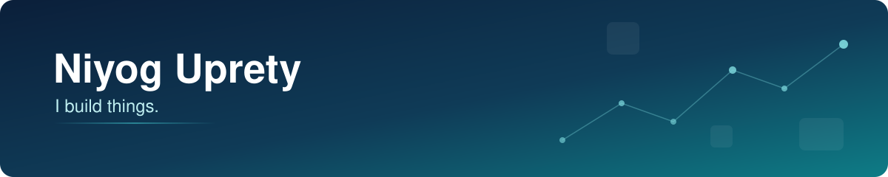

  

Sometimes it's a product, sometimes it's a pipeline, sometimes it starts with a messy dataset.

I like figuring out how things work, connecting the pieces, and making something useful.

 

## Tech Stack

<b>Languages</b> 
<picture><source media="(prefers-color-scheme: dark)" srcset="assets/stack/python-dark.svg"></picture>
<picture><source media="(prefers-color-scheme: dark)" srcset="assets/stack/sql-dark.svg"></picture>
<picture><source media="(prefers-color-scheme: dark)" srcset="assets/stack/typescript-dark.svg"></picture>
<picture><source media="(prefers-color-scheme: dark)" srcset="assets/stack/javascript-dark.svg"></picture>
<picture><source media="(prefers-color-scheme: dark)" srcset="assets/stack/r-dark.svg"></picture>

<b>Databases</b> 
<picture><source media="(prefers-color-scheme: dark)" srcset="assets/stack/postgresql-dark.svg"></picture>
<picture><source media="(prefers-color-scheme: dark)" srcset="assets/stack/mysql-dark.svg"></picture>

<b>APIs & Backend</b> 
<picture><source media="(prefers-color-scheme: dark)" srcset="assets/stack/rest-apis-dark.svg"></picture>
<picture><source media="(prefers-color-scheme: dark)" srcset="assets/stack/fastapi-dark.svg"></picture>

<b>Data & Visualization</b> 
<picture><source media="(prefers-color-scheme: dark)" srcset="assets/stack/powerbi-dark.svg"></picture>
<picture><source media="(prefers-color-scheme: dark)" srcset="assets/stack/pandas-dark.svg"></picture>
<picture><source media="(prefers-color-scheme: dark)" srcset="assets/stack/numpy-dark.svg"></picture>
<picture><source media="(prefers-color-scheme: dark)" srcset="assets/stack/tidyverse-dark.svg"></picture>

<b>Cloud & Infrastructure</b> 
<picture><source media="(prefers-color-scheme: dark)" srcset="assets/stack/aws-dark.svg"></picture>
<picture><source media="(prefers-color-scheme: dark)" srcset="assets/stack/supabase-dark.svg"></picture>
<picture><source media="(prefers-color-scheme: dark)" srcset="assets/stack/vercel-dark.svg"></picture>
<picture><source media="(prefers-color-scheme: dark)" srcset="assets/stack/cloudflare-dark.svg"></picture>
 AWS is where my Job Market Intelligence pipeline will run once it's deployed.

<b>Web Development</b> 
<picture><source media="(prefers-color-scheme: dark)" srcset="assets/stack/nextjs-dark.svg"></picture>
<picture><source media="(prefers-color-scheme: dark)" srcset="assets/stack/react-dark.svg"></picture>
<picture><source media="(prefers-color-scheme: dark)" srcset="assets/stack/tailwindcss-dark.svg"></picture>

<b>Development Tools</b> 
<picture><source media="(prefers-color-scheme: dark)" srcset="assets/stack/git-dark.svg"></picture>
<picture><source media="(prefers-color-scheme: dark)" srcset="assets/stack/github-dark.svg"></picture>
<picture><source media="(prefers-color-scheme: dark)" srcset="assets/stack/jupyter-dark.svg"></picture>
<picture><source media="(prefers-color-scheme: dark)" srcset="assets/stack/rstudio-dark.svg"></picture>
<picture><source media="(prefers-color-scheme: dark)" srcset="assets/stack/mysql-workbench-dark.svg"></picture>
<picture><source media="(prefers-color-scheme: dark)" srcset="assets/stack/cursor-dark.svg"></picture>

 

## Products I've Built

<h3>
  
  &nbsp;<a href="https://talentyak.com">TalentYak</a>
</h3>

Online fitness coaching for Nepalis living abroad, with independent coaches based in Nepal.

**Role:** Solo developer

I designed and built TalentYak, from the database and backend to the frontend and deployment. It has account sign-in, coach-written workout and nutrition plans, weekly check-ins with coach feedback, messaging between coaches and clients, and progress tracking for workouts, body measurements and meals.

Next.js · TypeScript · Supabase (PostgreSQL) · Vercel · Cloudflare R2 
<a href="https://talentyak.com">talentyak.com</a> &nbsp;·&nbsp; Source code private

<h3>
  
  &nbsp;<a href="https://nepgram.com">Nepgram</a>
</h3>

A travel marketplace for Nepal where people can book treks, stays, buses and transfers.

**Role:** Backend contributor

Worked on partner onboarding APIs, booking workflows, and relational database design as part of a two-person team.

<a href="https://nepgram.com">nepgram.com</a> &nbsp;·&nbsp; Source code private

<h3>
  
  &nbsp;<a href="https://meetmerchants.com">Meet Merchants</a>
</h3>

A B2B marketplace for Nepal that connects businesses with verified local suppliers.

**Role:** Solo developer

I designed and built Meet Merchants myself, from the database and backend to the frontend and deployment. It has a supplier onboarding flow with draft saving and document upload, an admin review queue I use to verify suppliers, supplier profiles with product catalogs, and search by category and city.

Next.js · TypeScript · Supabase (PostgreSQL) · Tailwind CSS · Vercel · Cloudflare 
<a href="https://meetmerchants.com">meetmerchants.com</a> &nbsp;·&nbsp; Source code private

 

## Projects

### Data Analytics & Visualization

**[Vendor Performance Analysis](https://github.com/Niyog59/Vendor-Performance-Analysis-SQL-Python-PowerBI)** 
Loads retail sales and inventory data into SQLite, then finds underperforming brands, vendor concentration, bulk-buying savings and unsold stock, with a Power BI dashboard on top. 
Python · SQLite · pandas · NumPy · SciPy · Power BI

**[Airline Occupancy & Revenue Analysis](https://github.com/Niyog59/Airlines-Data-Analysis-SQL-Python)** 
Queries an airline booking database to compare seat occupancy and revenue across aircraft, and estimates what a 10% bump in occupancy would bring in. 
SQL · SQLite · Python · pandas · Matplotlib · Seaborn

**[Airline Route Profitability](https://github.com/Niyog59/Airline-Profitability)** 
A group project in R that looks at a simulated year of flight data out of Dubai to see whether route type, season, demand or load factor matters most for profit. 
R · tidyverse · ggplot2 · R Markdown

**[Sector Rotation in the Stock Market](https://github.com/Niyog59/Sector-Rotation-in-the-Stock-Market)** 
Pulls 25 years of S&P 500 sector ETF prices and tracks which sectors held up during crashes and which ones led the recoveries. 
R · tidyverse · tidyquant · ggplot2

### Backend & APIs

**[Geocoding API](https://github.com/Niyog59/Geocoding-API)** 
A FastAPI service on top of OpenStreetMap's Nominatim for address search, reverse lookup and autocomplete, with API keys, rate limiting and response caching. 
Python · FastAPI · httpx · REST API

### SQL & Database Design

**[Gym Management System](https://github.com/Niyog59/Gym-Management-Project-MySQL)** 
A MySQL database for running a gym, with an ER diagram, a 3NF design across 5 tables, and tested queries for each use case. 
MySQL · MySQL Workbench · draw.io

### Experiments & Prototypes

**[SewaPrabaha](https://github.com/Niyog59/SewaPrabaha)** 
The starting setup for a Nepali services marketplace: a monorepo with a Next.js frontend and an Express API. It's an early scaffold, not a finished app. 
JavaScript · Next.js · Express · Node.js
